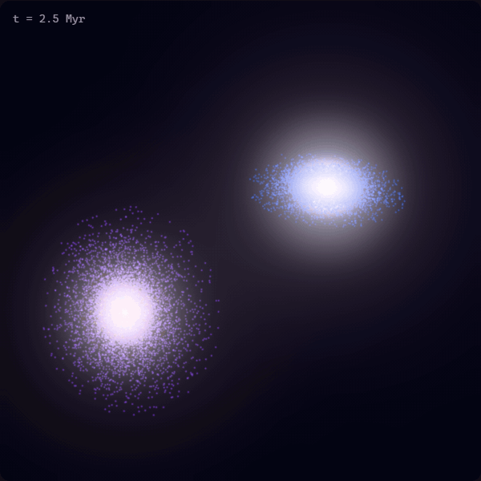
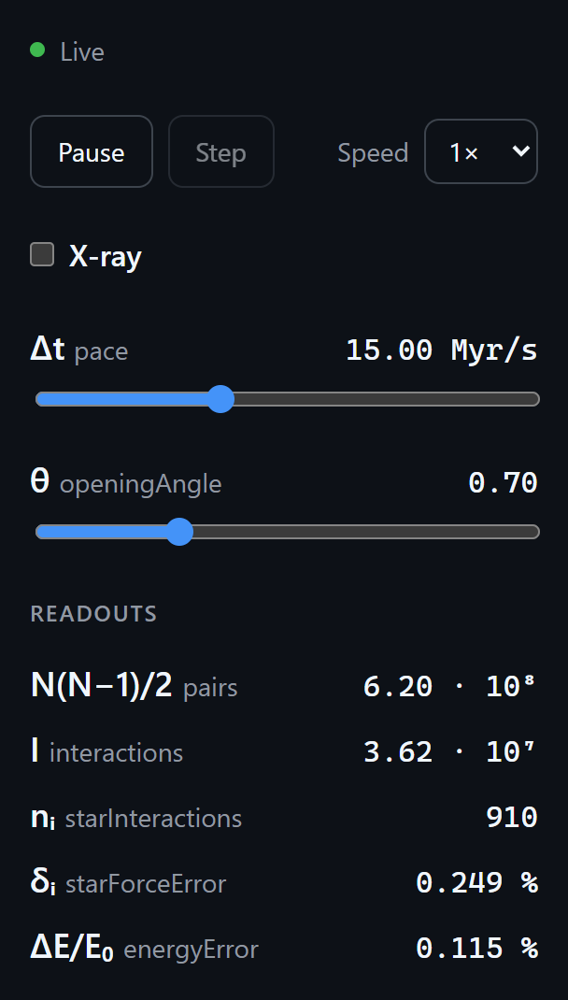
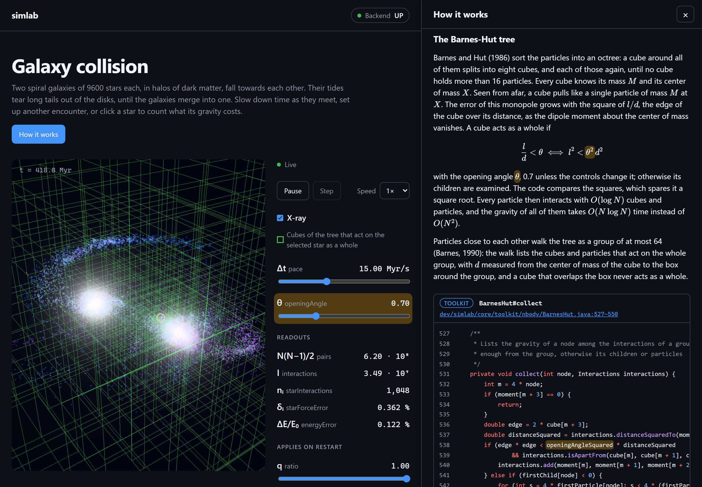

# simlab

Physics simulations in Java. A Spring Boot server computes them, the browser draws them live, and
each one comes with a lesson that shows the math and the code that actually runs.

<p>
  
  
</p>

Two spiral galaxies, 35,200 stars and dark matter particles, all pulling on each other. That's 620
million pairs per step. A Barnes-Hut octree gets that down to about 35 million interactions, the
leapfrog method moves everything, and over the whole merger the energy stays within 0.3%. The
server does the physics, the browser just draws the 30 frames a second it gets.

The readouts on the right count what gravity costs. Click a star and they show how many cubes and
particles it sums up instead of the other 35,199, and how far its force is off the exact sum. Drag
θ and the tree trades accuracy for speed while it runs.

## How it works



The **How it works** button opens the lesson. It goes through the equations and shows the methods
from this repo that compute them, straight from the source and linked to their lines on GitHub.
Point at a symbol like θ and it lights up in the formula, in the code and on its slider. Experiments
set the parameters for you, calculations fill in with live values, and the x-ray (green) shows which
cubes of the tree pull on the selected star as a whole.

<details>
<summary><b>The math in short</b></summary>

Gravity is softened over $\varepsilon = 0.2$ kpc so close passes don't fling particles away. With
$G = 1$ the acceleration of particle $i$ is

```math
\ddot x_i = \sum_{j \ne i} m_j \, \frac{x_j - x_i}{\left( \lVert x_j - x_i \rVert^2 + \varepsilon^2 \right)^{3/2}}
```

The octree splits space into cubes that hold at most 16 particles, and every cube knows its mass and
center of mass. A cube with edge $l$ at distance $d$ acts like a single particle at its center of
mass if

```math
\frac{l}{d} < \theta
```

so each particle sums up $O(\log N)$ cubes and particles instead of $N - 1$. At $\theta = 0.7$ the
median force error is 0.3%. Particles walk the tree in groups of up to 64 in parallel, about 7 ms
per evaluation on 24 threads.

The leapfrog goes drift, kick, drift and needs one gravity evaluation per step:

```math
\begin{aligned}
x_{n+1/2} &= x_n + \tfrac{\Delta t}{2}\, v_n \\
v_{n+1} &= v_n + \Delta t\, a(x_{n+1/2}) \\
x_{n+1} &= x_{n+1/2} + \tfrac{\Delta t}{2}\, v_{n+1}
\end{aligned}
```

It's symplectic, so the energy error stays bounded instead of piling up. Every 30 steps a finer tree
measures the total energy, and the readout shows $\Delta E / E_0$.

Both galaxies start in equilibrium (Hernquist 1993): exponential disks with Toomre $Q = 1.2$, bulges
and dark matter halos whose random motions solve the Jeans equation. The
[lesson](backend/sim-core/src/main/resources/dev/simlab/core/simulations/galaxy/lesson.md) goes
through all of it, with sources.

</details>

## Simulations

- **Galaxy collision**: N-body gravity with a Barnes-Hut octree and the leapfrog method
- **Cloth**: 48x48 particles in gusty wind, over 13,000 constraints solved with XPBD. Grab it and
  pull
- **Lorenz attractor**: 1,000 particles pulled apart by chaos, Runge-Kutta 4 or Euler with a step
  you pick

Each one can pause, step, slow down to 1/8, show an x-ray and change its parameters while it runs.

## Tech stack

| Area     | Choice                                                                    |
| -------- | ------------------------------------------------------------------------- |
| Backend  | Java 25, Spring Boot 4.1, Gradle 9 (Kotlin DSL), JavaParser               |
| Frontend | Vue 3, TypeScript, Vite, Pinia, Three.js, KaTeX, Shiki                    |
| Tests    | JUnit 6, AssertJ, ArchUnit, Vitest, Playwright                            |
| Quality  | Error Prone, NullAway, Spotless, ESLint, Oxlint, Prettier, GitHub Actions |

Every open page gets its own room on the server. The room ticks 30 times a second: it applies new
inputs, steps the simulation and sends one binary frame over a WebSocket, a 16-byte header followed
by float32s that the browser reads as a typed array. Inputs go back as small JSON messages.

## Run it

You need a JDK 17 or newer for Gradle, which downloads the Java 25 toolchain itself, and Node.js 24.

```bash
# terminal 1: backend on port 8080
cd backend
./gradlew :sim-server:bootRun

# terminal 2: frontend on http://localhost:5173
cd frontend
npm ci
npm run dev
```

CI runs `./gradlew build` for the backend and lint, format check, type check, Vitest and Playwright
for the frontend.

## Add a simulation

Everything goes into `backend/sim-core`, the server and the frontend find it on their own.

1. Create a package `dev.simlab.core.simulations.<name>`.
2. Implement `Simulation`: apply inputs, advance in time, write the state as floats.
3. Implement `SimulationDefinition`: a type for the URL, the parameters (a range or a few options,
   live or on restart) and the scene. The scene lists what the browser draws (point clouds, meshes,
   spheres, a floor, lines, cubes and readouts), and a frame is just their floats in that order.
   Point clouds can be clickable, meshes grabbable, and a second list of objects makes the x-ray.
4. Put a `lesson.md` into the package's resources. It's Markdown with TeX. A line with nothing but
   `` `Leapfrog#step` `` embeds that method's code, `\class{sigma}{\sigma}` marks a symbol that the
   YAML head ties to a parameter, readout or variable, and `experiment` and `calculation` blocks add
   experiments and live formulas.

Restart the server and the start page lists it. If a lesson refers to a method, symbol or parameter
that doesn't exist, the server won't start and the build fails, so lessons can't fall behind the
code. The toolkit has ODE solvers, position-based dynamics, Barnes-Hut with leapfrog and smooth
noise, and
[`LorenzDefinition`](backend/sim-core/src/main/java/dev/simlab/core/simulations/lorenz/LorenzDefinition.java)
is a small example to start from.

## License

MIT, see [LICENSE](LICENSE).
